# SAP S/4HANA ERP 구축 프로젝트 포트폴리오

**최민준** — PP(생산관리) 모듈 개발 · 프로젝트 PM
SAP CODE 아카데미 1기 | 코드라보 조 | 2026.03 – 2026.07

> 가상 화장품 기업 **SKINCODE**(연매출 850억, 시카·수분 라인 5종)의 전사 업무 통합을 위한
> SAP S/4HANA 기반 커스텀 ERP 구축 — 5개 모듈(PP·MM·SD·FI·CO), 8인 팀 프로젝트

📄 **[전체 포트폴리오 PDF 보기](./portfolio.pdf)**

---

## 담당 역할

- **PP(생산관리) 모듈 전체 단독 설계·개발**
- **프로젝트 PM**: 일정 관리, 모듈 간 인터페이스 조율, 통합 시나리오 총괄, 중간평가 피드백 전수 개선 관리

## 구현 프로세스 (End-to-End)

```
BOM 기준정보 관리 → 생산계획 수립 → MRP(순소요량 산출) → 계획오더
→ 생산오더 → 공정완료 · 261출고 · 101입고 → 실적 역추적
```

## 개발 산출물

| 구분 | 내용 |
|---|---|
| ABAP 프로그램 | 트랜잭션 3종(BOM 관리 모듈풀, 생산계획/MRP, 생산오더) + 조회 3종(BOM 조회, 라우팅 조회 모듈풀, 실적 역추적) + Function Module 1종 |
| Fiori 앱 | 3종 — MRP 결과조회(차트), 라우팅 모니터링 Cockpit(3D/차트), Work Center Management(CUD·팝업) — UI5 Freestyle, 런치패드 배포 |
| 서비스/데이터 | RAP 기반 OData v4 서비스 3종 · CDS View 9본+ · DB View 2본 · Maintenance View 1본 |
| 테이블 설계 | 커스텀 테이블 12개 (ZTC4PP0001~0012) |

**기술 스택**: SAP GUI · SAP Fiori | ABAP · UI5 · RAP · HTML/CSS/JS | Eclipse ADT · VSCode

---

## 프로젝트 개요

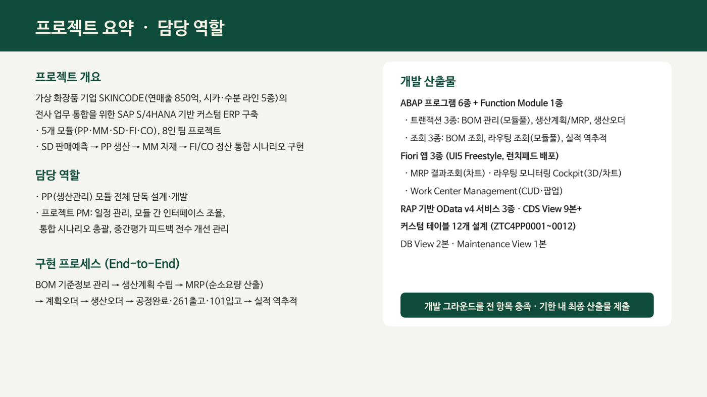

## 모듈 간 프로세스 흐름 (PM)

SD 판매예측 → PP 생산 → MM 자재 → FI/CO 정산으로 이어지는 통합 시나리오를 설계·조율했습니다.

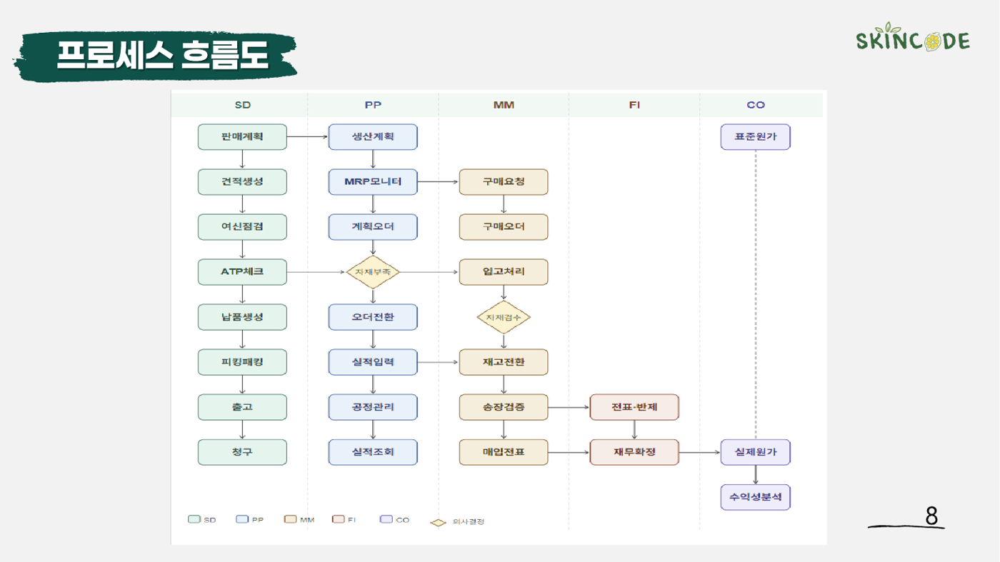

---

## 개발 프로그램 상세

### 1. BOM 생성·수정·삭제 (SAPMZC4PP0001, 모듈풀)

완제품 기반 BOM 다중 관리 — Splitter Container 2단 화면, 조회↔변경 토글, ALV 커스텀 툴바 Insert/Delete Row, Memory ID 파라미터 자동 연동

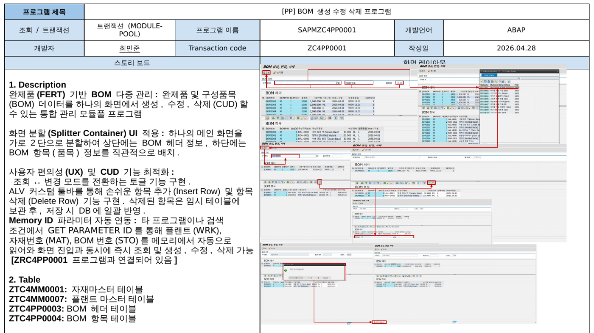

### 2. BOM 조회 (ZRC4PP0001)

ALV TREE 기반 전체 BOM 구조 탐색 — 더블클릭 연동 조회, 핫스팟 자재 상세 HTML 표시, 관리 트랜잭션 호출 연계

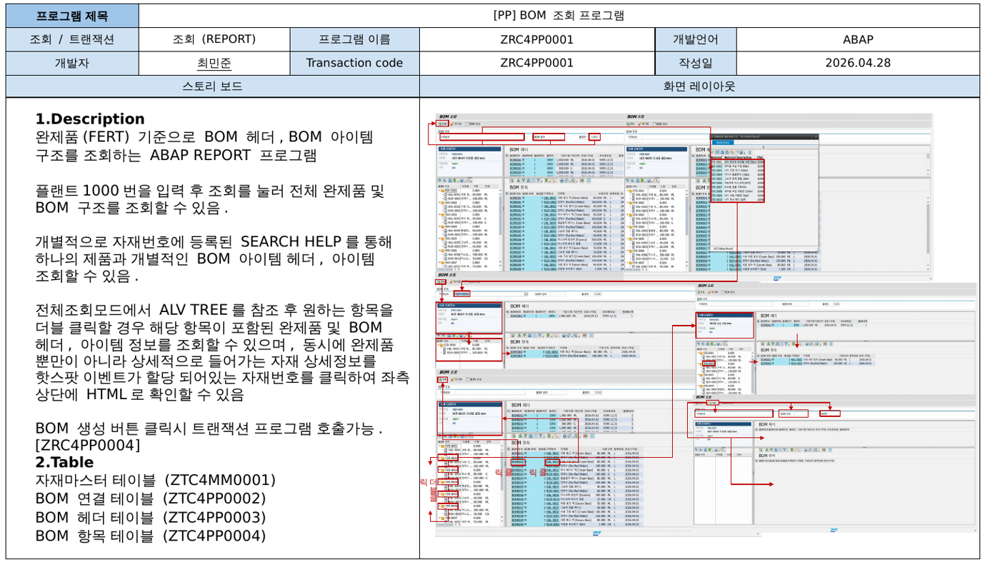

### 3. 라우팅 조회 (SAPMZC4PP0002, 모듈풀)

화면 4분할(트리/헤더 ALV/공정 ALV/Gantt Chart) — 자재유형별 라우팅 그룹 트리, 표준작업시간 기반 공정 순서 시각화

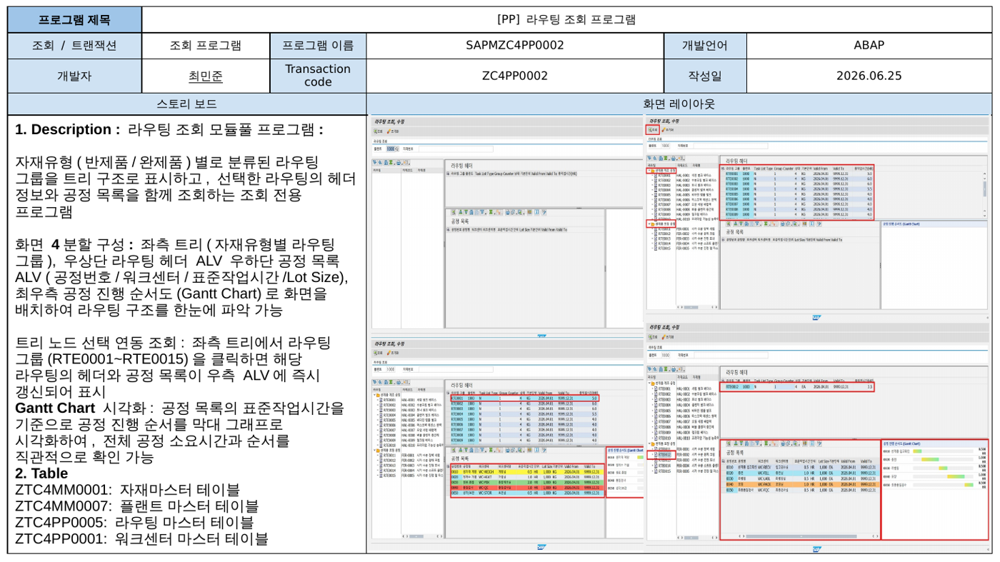

### 4. 생산계획 및 MRP (ZRC4PP0002)

SD 판매계획 → PP 생산계획 자동 반영, 재고 차감 후 부족수량 기준 계획오더 생성, 계획오더→생산오더 전환(자재유형별 저장위치 분기)

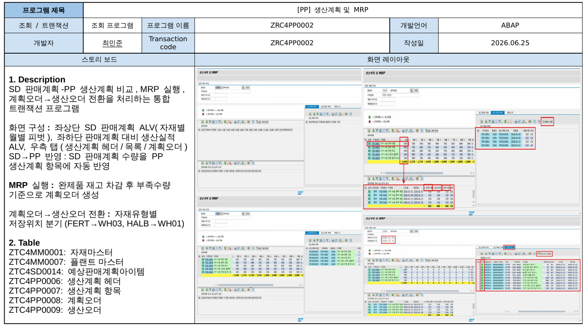

### 5. 생산오더 및 생산 (ZRC4PP0003)

생산 시작(공정 순차 완료 + 원자재 261출고) → 생산완료(실적수량 101입고) 통합 처리, 상태 필터 다중 선택

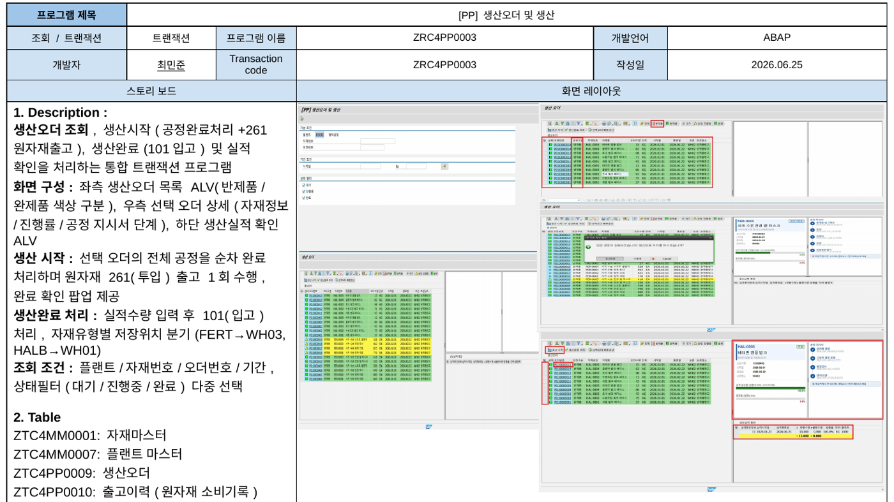

### 6. 생산실적 역추적 (ZRC4PP0004)

완제품 배치(101) → 투입 원자재 배치(261) → 주차별 생산계획까지 연계 추적 — 오더 선택 시 3개 패널 동시 갱신

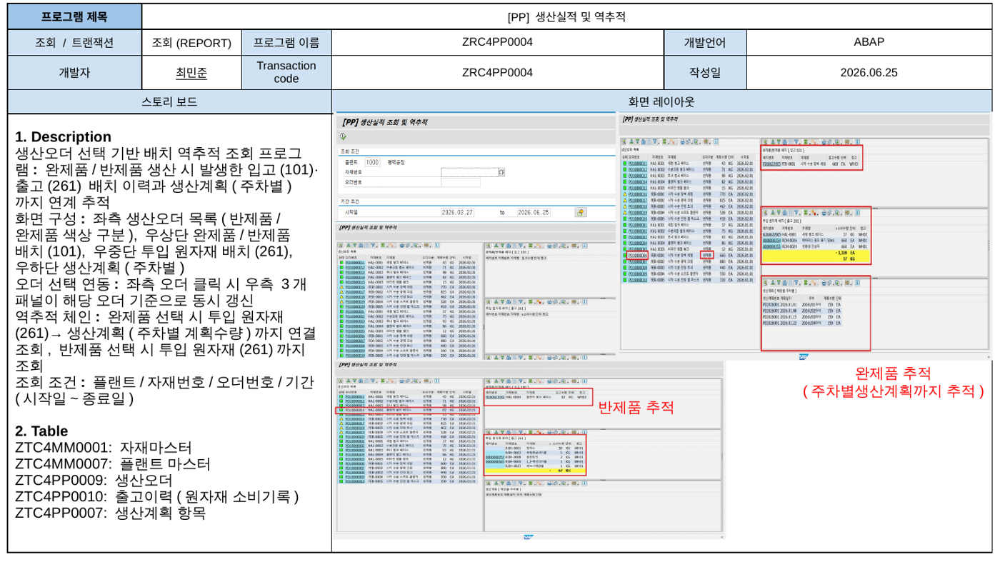

### 7. Fiori — 라우팅 공정 모니터링 Cockpit

KPI 타일 · 3D 공장 시각화(클릭 시 CCTV 팝업) · 간트차트/공정흐름도 자체 HTML/SVG 구현 · 도넛/가동률 차트 sap.viz VizFrame — RAP OData v4

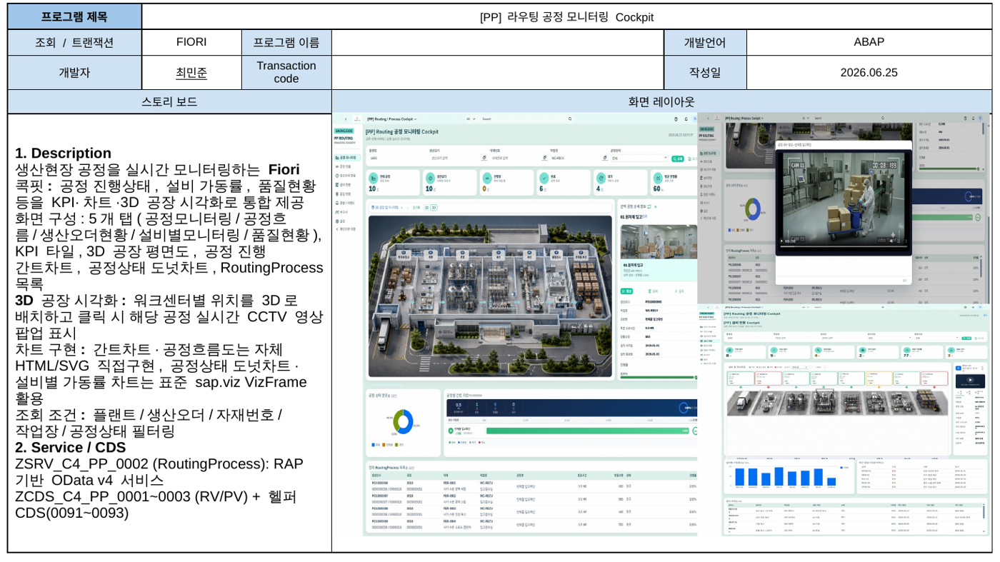

### 8. Fiori — Work Center Management

워크센터 마스터 CUD 앱 — MessageBox 확인 팝업, OData v4 submitBatch, 필수값/기간/중복 유효성 검사 — RAP managed Behavior

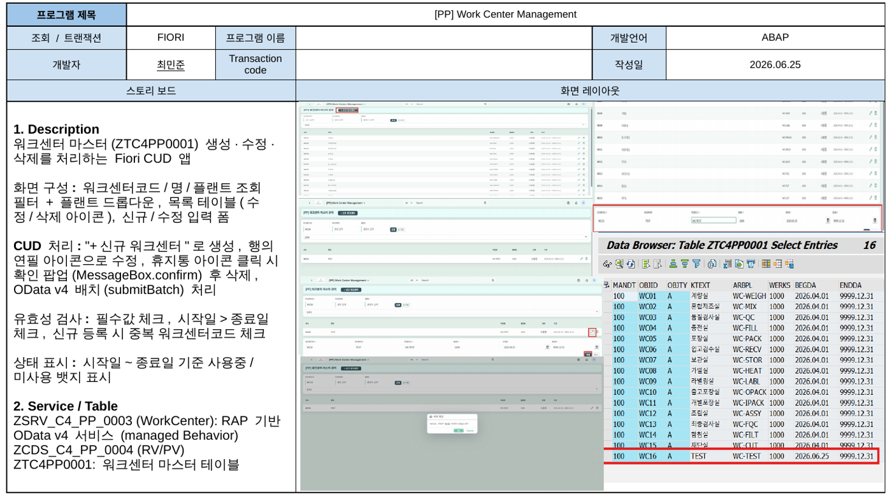

---

## 성과 및 배운 점

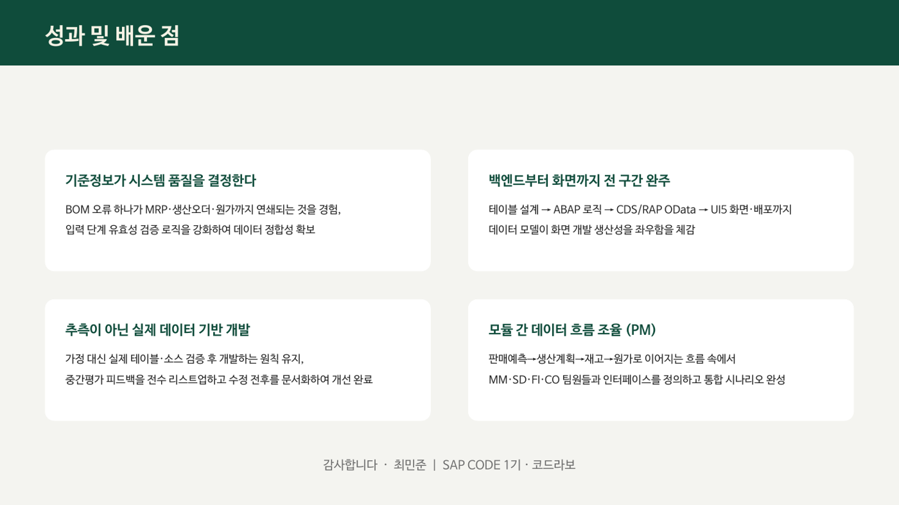

- **기준정보가 시스템 품질을 결정한다** — BOM 오류 하나가 MRP·생산오더·원가까지 연쇄되는 것을 경험, 입력 단계 유효성 검증 강화
- **백엔드부터 화면까지 전 구간 완주** — 테이블 설계부터 UI5 배포까지, 데이터 모델이 화면 개발 생산성을 좌우함을 체감
- **추측이 아닌 실제 데이터 기반 개발** — 중간평가 피드백 전수 리스트업, 수정 전후 문서화하여 개선 완료
- **모듈 간 데이터 흐름 조율(PM)** — MM·SD·FI·CO 팀원들과 인터페이스를 정의하고 통합 시나리오 완성
